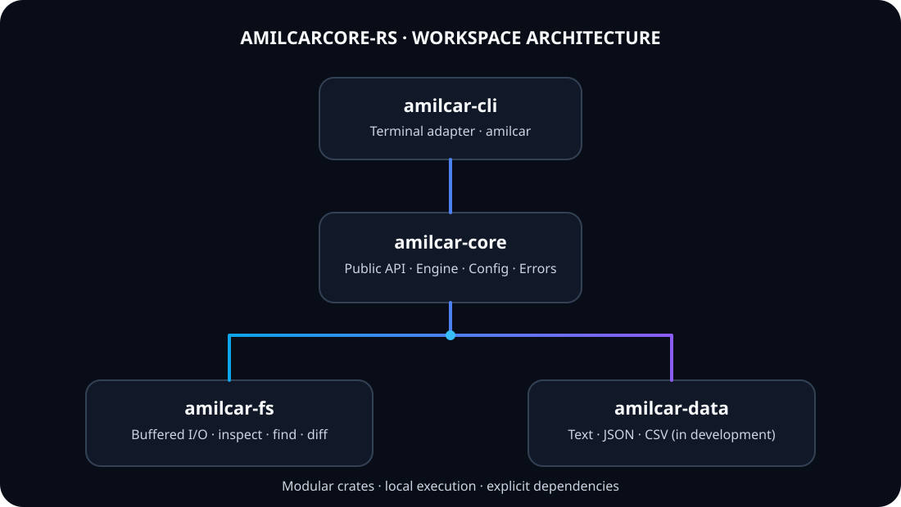
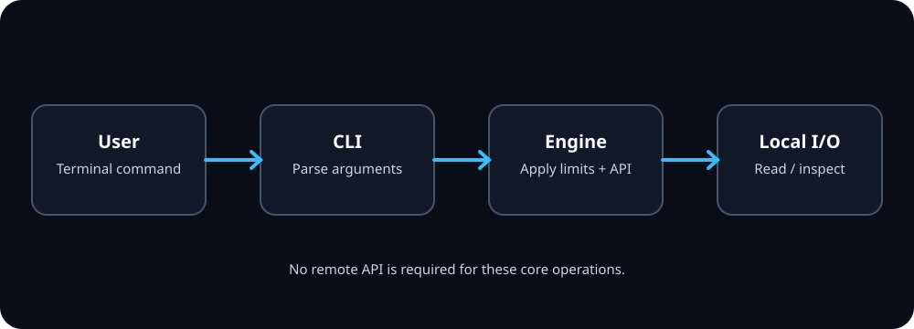

<div align="center">
  
  <h1>AmilcarCore-RS</h1>
  <p><strong>Motor nativo de procesamiento local · Rust</strong></p>
  <p>Biblioteca modular y CLI para inspección y procesamiento de archivos, con enfoque local-first.</p>
  <p><a href="docs/guide-es.html">Guía visual en español</a> · <a href="docs/guide-en.html">English visual guide</a> · <a href="docs/INSTALLATION.md">Instalación</a></p>
  <p>
    
    
    
    
    <a href="https://github.com/AmilcarGit/AmilcarCore-RS/actions/workflows/ci.yml"></a>
    
  </p>
</div>

**[🇪🇸 Español](#español) · [🇬🇧 English](#english)**

---

# Español

## ¿Qué es AmilcarCore-RS?

AmilcarCore-RS es un workspace modular escrito en Rust. Ofrece una biblioteca reutilizable y una interfaz de línea de comandos para inspeccionar, comparar y buscar archivos localmente.

> **Estado:** desarrollo temprano · Etapa 3 — operaciones avanzadas del sistema de archivos. Las API pueden cambiar antes de una versión estable.

### Características disponibles

- Inspección de metadatos de archivos y directorios.
- Comparación de archivos por bloques y detección del primer byte diferente.
- Búsqueda recursiva por extensión o fragmento del nombre.
- Lectura y procesamiento con límites configurables.
- Copia de archivos con protección contra sobrescritura por defecto.
- Movimiento y renombrado de rutas con comprobación de destino.
- Creación de directorios y eliminación segura de archivos/directorios vacíos.
- Hash SHA-256 en streaming y agrupación de archivos duplicados.
- Escrituras explícitas: crear sin sobrescribir o sobrescribir solo cuando se solicita.
- Ejecución local para las operaciones core documentadas.

### Versiones y compatibilidad

| Elemento | Valor |
| --- | --- |
| Versión del workspace | <code>0.1.0</code> |
| Rust mínimo (MSRV) | <code>1.75</code> |
| Edition | Rust 2021 |
| Licencia | <code>MIT OR Apache-2.0</code> |
| Plataformas CI | Linux, Windows y macOS |
| Android / Termux | Compilación local sujeta a la toolchain y arquitectura disponibles |
| Estado | Desarrollo temprano |

La insignia de CI muestra el estado del workflow de GitHub Actions en <code>main</code>. La compatibilidad Android/Termux no significa que existan APK o binarios precompilados.

## Arquitectura del workspace


| Crate | Responsabilidad |
| --- | --- |
| <code>amilcar-core</code> | API pública, motor, configuración y errores compartidos |
| <code>amilcar-fs</code> | Operaciones del sistema de archivos |
| <code>amilcar-data</code> | Procesamiento de texto y datos estructurados; en desarrollo |
| <code>amilcar-cli</code> | Interfaz de terminal que consume la biblioteca |

### Flujo de ejecución



~~~mermaid
flowchart TD
    U[Usuario / Terminal] --> CLI[amilcar-cli]
    CLI --> CORE[amilcar-core]
    CORE --> FS[amilcar-fs]
    CORE --> DATA[amilcar-data]
    FS --> IO[Operaciones locales de archivos]
    DATA --> PROC[Procesamiento de datos]
~~~

El CLI actúa como adaptador. La lógica reutilizable pertenece a las bibliotecas y no se duplica en la interfaz de terminal.

## Instalación paso a paso

AmilcarCore-RS se compila en tu propio dispositivo. Necesitas Git, Rust y Cargo **1.75 o superior**. La primera compilación necesita conexión para descargar el repositorio y las dependencias; las operaciones del motor se ejecutan localmente.

### Android con Termux

**1. Actualiza los paquetes e instala los requisitos**

```sh
pkg update && pkg upgrade
pkg install git rust
```

**2. Comprueba Rust, Cargo y Git**

```sh
rustc --version
cargo --version
git --version
```

Rust debe ser 1.75 o superior. Si es anterior, actualiza tu toolchain antes de continuar.

**3. Descarga el repositorio**

```sh
git clone https://github.com/AmilcarGit/AmilcarCore-RS.git
cd AmilcarCore-RS
```

**4. Compila e instala**

```sh
sh scripts/install.sh
```

El instalador compila el CLI en modo release y copia el ejecutable a `$HOME/.local/bin/amilcar`. La compilación puede tardar varios minutos según el dispositivo.

**5. Añade el ejecutable al PATH**

Si el instalador indica que `$HOME/.local/bin` no está en tu PATH:

```sh
echo 'export PATH="$HOME/.local/bin:$PATH"' >> ~/.bashrc
source ~/.bashrc
```

**6. Verifica la instalación**

```sh
amilcar --version
amilcar info
amilcar --help
amilcar file --help
```

**7. Prueba los comandos**

```sh
mkdir -p ~/amilcar-prueba
cd ~/amilcar-prueba
echo "Hola AmilcarCore" > origen.txt
amilcar file inspect origen.txt
amilcar file copy origen.txt copia.txt
amilcar file hash origen.txt
amilcar file diff origen.txt copia.txt
amilcar file duplicates .
amilcar file mkdir datos/nuevo
amilcar file move copia.txt datos/copia.txt
```

### Linux

**1. Instala Git y las herramientas de compilación.** En Debian/Ubuntu:

```sh
sudo apt update
sudo apt install -y git build-essential curl
```

**2. Instala Rust estable** si tu distribución no proporciona Rust 1.75 o superior:

```sh
curl --proto '=https' --tlsv1.2 -sSf https://sh.rustup.rs | sh
. "$HOME/.cargo/env"
rustup update stable
```

**3. Clona, compila e instala**

```sh
git clone https://github.com/AmilcarGit/AmilcarCore-RS.git
cd AmilcarCore-RS
sh scripts/install.sh
```

**4. Configura el PATH** si es necesario:

```sh
echo 'export PATH="$HOME/.local/bin:$PATH"' >> ~/.bashrc
source ~/.bashrc
```

**5. Verifica**

```sh
amilcar --version
amilcar info
amilcar --help
```

### Solución de problemas

- **`amilcar: command not found`:** el ejecutable aún no está instalado o `$HOME/.local/bin` no está en el PATH. Ejecuta el instalador y configura el PATH.
- **`cargo: command not found`:** instala Rust y Cargo y vuelve a abrir la terminal.
- **Rust anterior a 1.75:** actualiza Rust estable antes de compilar.
- **La compilación falla o Termux se queda sin memoria:** revisa el error, cierra otras aplicaciones y vuelve a ejecutar `sh scripts/install.sh`.
- **El comando sigue sin aparecer:** comprueba que exista `$HOME/.local/bin/amilcar` y ejecuta `export PATH="$HOME/.local/bin:$PATH"`.

> **Nota Android:** Termux compila el programa en el propio dispositivo. La compatibilidad depende de la arquitectura y la toolchain disponibles. No se distribuyen APK ni binarios Android precompilados.

Consulta la [guía completa](docs/INSTALLATION.md) y la [guía visual](docs/guide-es.html).

## Demostración de terminal



La animación muestra la salida real del comando <code>amilcar info</code>. Para inspeccionar tus propios archivos:

~~~sh
amilcar file inspect ./documento.txt
~~~

El tamaño y los metadatos mostrados dependen del archivo local.

## Ejemplos de comandos

~~~sh
# Información del motor
amilcar info

# Inspeccionar metadatos
amilcar file inspect ./documento.txt

# Comparar dos archivos
amilcar file diff ./original.txt ./copia.txt

# Buscar JSON recursivamente
amilcar file find ./documentos --extension json

# Buscar por fragmento del nombre
amilcar file find ./proyecto --name config

# Copiar (no sobrescribe salvo --overwrite)
amilcar file copy ./origen.txt ./copia.txt
amilcar file copy ./origen.txt ./copia.txt --overwrite

# Mover y renombrar
amilcar file move ./copia.txt ./archivo.txt
amilcar file rename ./archivo.txt final.txt

# Crear y eliminar directorios
amilcar file mkdir ./datos/nuevo
amilcar file rmdir ./datos/nuevo

# Eliminar un archivo
amilcar file remove ./archivo.txt

# SHA-256 y duplicados
amilcar file hash ./archivo.txt
amilcar file duplicates ./documentos --max-entries 100000
~~~

## Seguridad y diseño

- No se requieren APIs externas ni servidor remoto para las operaciones core documentadas.
- No se siguen enlaces simbólicos durante la búsqueda recursiva.
- Los límites de entradas y tamaños reducen el riesgo de consumir recursos sin control.
- La copia no sobrescribe archivos de forma predeterminada; el modo de reemplazo requiere <code>--overwrite</code>. La eliminación de directorios solo admite directorios vacíos.
- Se evita <code>unsafe</code> salvo que exista una justificación técnica documentada.

## Hoja de ruta

El procesamiento ampliado de texto, JSON/CSV, más comandos, benchmarks y verificación completa en plataformas adicionales siguen en desarrollo. No se presentan como funciones terminadas.

## Licencia

Puedes elegir entre [MIT](LICENSE-MIT) o [Apache License 2.0](LICENSE-APACHE).

---

# English

## What is AmilcarCore-RS?

AmilcarCore-RS is a modular Rust workspace. It provides a reusable library and a command-line interface for local file inspection, comparison and search.

> **Status:** early development · Stage 3 — advanced filesystem operations. APIs may change before a stable release.

### Available features

- File and directory metadata inspection.
- Buffered file comparison and first differing byte detection.
- Recursive search by extension or filename substring.
- Bounded reading and processing primitives.
- File copying refuses replacement unless explicitly requested.
- Move and rename operations check destination conflicts.
- Directory creation and safe removal of files/empty directories.
- Streaming SHA-256 and duplicate-file grouping.
- Explicit write modes: create without replacement, or overwrite only when requested.
- Local execution for the documented core operations.

### Version and compatibility

| Item | Value |
| --- | --- |
| Workspace version | <code>0.1.0</code> |
| Minimum Rust version (MSRV) | <code>1.75</code> |
| Edition | Rust 2021 |
| License | <code>MIT OR Apache-2.0</code> |
| CI platforms | Linux, Windows and macOS |
| Android / Termux | Local compilation depends on the available toolchain and architecture |
| Status | Early development |

The CI badge reflects the GitHub Actions workflow on <code>main</code>. Android/Termux support does not mean prebuilt APKs or Android binaries are currently published.

## Workspace architecture


| Crate | Responsibility |
| --- | --- |
| <code>amilcar-core</code> | Public API, engine, configuration and shared errors |
| <code>amilcar-fs</code> | Filesystem operations |
| <code>amilcar-data</code> | Text and structured-data processing; in development |
| <code>amilcar-cli</code> | Terminal interface built on the library |

### Execution flow


~~~mermaid
flowchart TD
    U[User / Terminal] --> CLI[amilcar-cli]
    CLI --> CORE[amilcar-core]
    CORE --> FS[amilcar-fs]
    CORE --> DATA[amilcar-data]
    FS --> IO[Local filesystem operations]
    DATA --> PROC[Data processing]
~~~

The CLI is an adapter. Reusable logic belongs in the libraries rather than being duplicated in the terminal interface.

## Step-by-step installation

AmilcarCore-RS is compiled on your own device. You need Git, Rust and Cargo **1.75 or newer**. The first build requires an internet connection to download the repository and Cargo dependencies; engine operations run locally.

### Android with Termux

**1. Update packages and install requirements**

```sh
pkg update && pkg upgrade
pkg install git rust
```

**2. Check Rust, Cargo and Git**

```sh
rustc --version
cargo --version
git --version
```

Rust must be version 1.75 or newer.

**3. Clone the repository**

```sh
git clone https://github.com/AmilcarGit/AmilcarCore-RS.git
cd AmilcarCore-RS
```

**4. Build and install**

```sh
sh scripts/install.sh
```

The installer builds the CLI in release mode and copies it to `$HOME/.local/bin/amilcar`. Build time depends on your device.

**5. Add the executable directory to PATH**

If the installer reports that `$HOME/.local/bin` is not in PATH:

```sh
echo 'export PATH="$HOME/.local/bin:$PATH"' >> ~/.bashrc
source ~/.bashrc
```

**6. Verify the installation**

```sh
amilcar --version
amilcar info
amilcar --help
amilcar file --help
```

**7. Try the commands**

```sh
mkdir -p ~/amilcar-test
cd ~/amilcar-test
echo "Hello AmilcarCore" > source.txt
amilcar file inspect source.txt
amilcar file copy source.txt copy.txt
amilcar file hash source.txt
amilcar file diff source.txt copy.txt
amilcar file duplicates .
amilcar file mkdir data/new
amilcar file move copy.txt data/copy.txt
```

### Linux

**1. Install Git and build tools.** On Debian/Ubuntu:

```sh
sudo apt update
sudo apt install -y git build-essential curl
```

**2. Install stable Rust** if your distribution does not provide Rust 1.75 or newer:

```sh
curl --proto '=https' --tlsv1.2 -sSf https://sh.rustup.rs | sh
. "$HOME/.cargo/env"
rustup update stable
```

**3. Clone, build and install**

```sh
git clone https://github.com/AmilcarGit/AmilcarCore-RS.git
cd AmilcarCore-RS
sh scripts/install.sh
```

**4. Configure PATH** if needed:

```sh
echo 'export PATH="$HOME/.local/bin:$PATH"' >> ~/.bashrc
source ~/.bashrc
```

**5. Verify**

```sh
amilcar --version
amilcar info
amilcar --help
```

### Troubleshooting

- **`amilcar: command not found`:** the executable is not installed or `$HOME/.local/bin` is missing from PATH. Run the installer and configure PATH.
- **`cargo: command not found`:** install Rust and Cargo, then reopen the terminal.
- **Rust older than 1.75:** update stable Rust before building.
- **Build fails or Termux runs out of memory:** inspect the error, close other apps and run `sh scripts/install.sh` again.
- **Command is still unavailable:** check that `$HOME/.local/bin/amilcar` exists and run `export PATH="$HOME/.local/bin:$PATH"`.

> **Android note:** Termux builds the program on the device. Compatibility depends on the available architecture and toolchain. No Android APKs or prebuilt Android binaries are distributed.

See the [complete installation guide](docs/INSTALLATION.md) and [visual guide](docs/guide-en.html).

## Terminal demonstration


The animation shows the actual output of <code>amilcar info</code>. To inspect your own files:

~~~sh
amilcar file inspect ./document.txt
~~~

Reported size and metadata depend on the local file.

## Command examples

~~~sh
# Engine information
amilcar info

# Inspect metadata
amilcar file inspect ./document.txt

# Compare files
amilcar file diff ./original.txt ./copy.txt

# Recursively find JSON files
amilcar file find ./documents --extension json

# Search by filename substring
amilcar file find ./project --name config

# Copy (does not overwrite unless --overwrite is passed)
amilcar file copy ./source.txt ./copy.txt
amilcar file copy ./source.txt ./copy.txt --overwrite

# Move and rename
amilcar file move ./copy.txt ./file.txt
amilcar file rename ./file.txt final.txt

# Create and remove directories
amilcar file mkdir ./data/new
amilcar file rmdir ./data/new

# Remove a file
amilcar file remove ./file.txt

# SHA-256 and duplicate detection
amilcar file hash ./file.txt
amilcar file duplicates ./documents --max-entries 100000
~~~

## Security and design

- No external API or remote server is required for the documented core operations.
- Recursive search does not follow symbolic links.
- Entry and size limits help control resource consumption.
- File copying does not overwrite by default; replacement requires <code>--overwrite</code>. Directory removal only accepts empty directories.
- <code>unsafe</code> is avoided unless technically justified and documented.

## Roadmap

Expanded text, JSON/CSV processing, additional commands, benchmarks and broader platform verification are still in development. They are not presented as completed features.

## License

Choose either the [MIT License](LICENSE-MIT) or [Apache License 2.0](LICENSE-APACHE).

---

<div align="center">
  <sub>Built with Rust · Maintained by <a href="https://github.com/AmilcarGit">AmilcarGit</a></sub>
</div>
